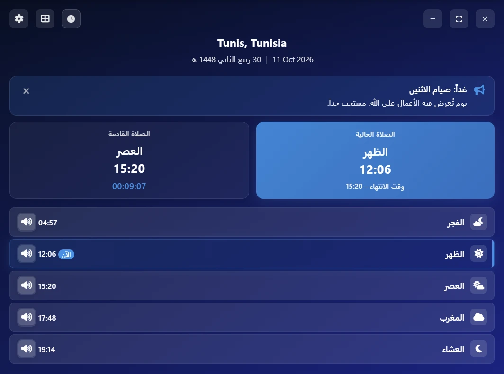
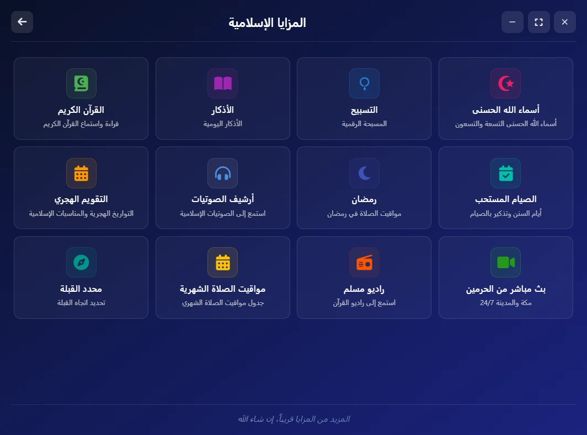
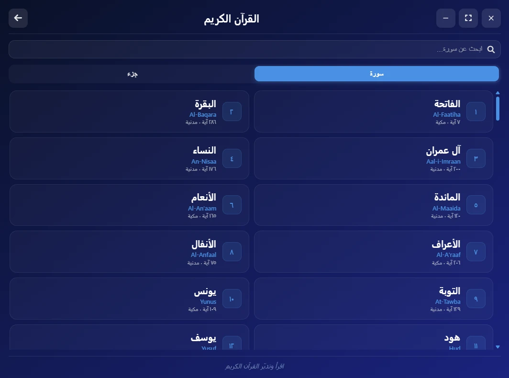
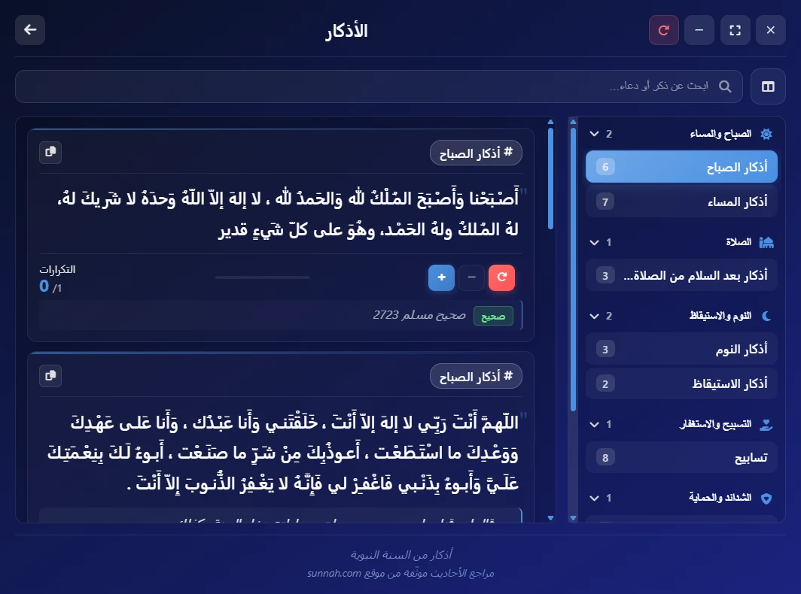
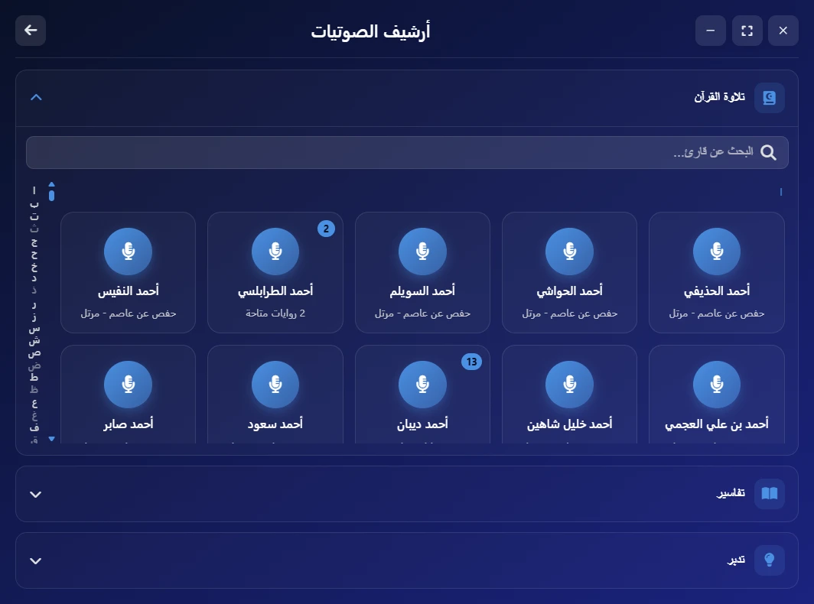
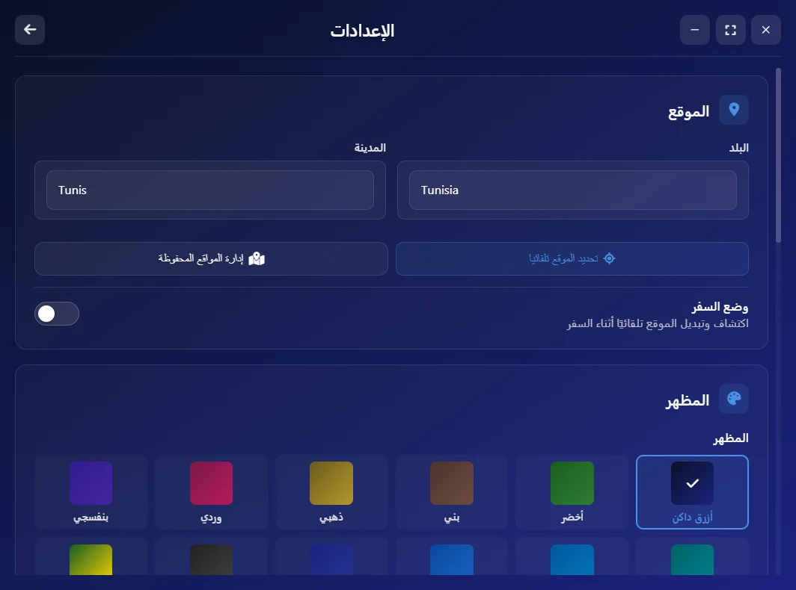

<div dir="rtl">

<div align="center">

# 🕌 Salaty Time

تطبيق إسلامي شامل لسطح المكتب: مواقيت الصلاة، القرآن الكريم، الأذكار وأدوات أخرى، في تطبيق واحد خفيف

[](https://github.com/yassindaboussi/Salaty/releases/latest)
[](LICENSE)
[](#-التحميل)

[English](README.md) · **العربية** · [Français](README.fr.md)

</div>

---

## 📑 المحتويات

- [نظرة عامة](#-نظرة-عامة)
- [التحميل](#-التحميل)
- [لقطات من التطبيق](#-لقطات-من-التطبيق)
- [المميزات](#-المميزات)
- [التقنيات المستخدمة](#️-التقنيات-المستخدمة)
- [هيكلة المشروع](#-هيكلة-المشروع)
- [التشغيل والتطوير](#-التشغيل-والتطوير)
- [المساهمة في المشروع](#-المساهمة-في-المشروع)
- [الترخيص](#-الترخيص)

---

## 🌙 نظرة عامة

تطبيق لسطح المكتب يجمع ما يحتاجه المسلم يوميًا في مكان واحد: مواقيت الصلاة، وقارئ للقرآن الكريم، وأرشيف صوتي للتلاوات والتدبر والتفاسير، والأذكار، وأدوات إسلامية متنوعة. يتوفر التطبيق بالعربية والإنجليزية والفرنسية، وتعمل أغلب ميزاته المهمة دون اتصال بالإنترنت.

---

## 📥 التحميل

| النظام | الملف | ملاحظات |
| --- | --- | --- |
| Windows 10/11 | [Salaty-Time-Setup.exe](https://github.com/yassindaboussi/Salaty/releases/latest/download/Salaty-Time-Setup.exe) | 64-bit |
| macOS 13+ | [Salaty-Time-mac-universal.dmg](https://github.com/yassindaboussi/Salaty/releases/latest/download/Salaty-Time-mac-universal.dmg) | لأجهزة Apple silicon وIntel |
| Linux | [Salaty-Time-linux-amd64.deb](https://github.com/yassindaboussi/Salaty/releases/latest/download/Salaty-Time-linux-amd64.deb) | لأنظمة Ubuntu وDebian وLinux Mint، ونسخ arm64 وAppImage للتوزيعات الأخرى في [صفحة الإصدارات](https://github.com/yassindaboussi/Salaty/releases/latest) |

- **ويندوز (Windows):** المثبّت غير موقّع رقميًا بعد، لذلك قد يظهر تحذير "Windows protected your PC" (SmartScreen): اضغط **More info** ثم **Run anyway**.
- **ماك (macOS):** التطبيق غير موثّق من Apple: افتحه مرة واحدة، ثم من **System Settings → Privacy & Security** اضغط **Open Anyway**.
- **التحديثات:** يبحث التطبيق عن الإصدارات الجديدة بنفسه، فيثبّتها على Windows وLinux، ويفتح صفحة التحميل على macOS.
- **التحقق من الملف:** يحتوي كل إصدار على ملف `SHA256SUMS.txt`، ولكل ملف شهادة بناء من GitHub: `gh attestation verify <file> --repo yassindaboussi/Salaty`

---

## 📸 لقطات من التطبيق

<div align="center">


<br/>


<br/>


</div>

---

## ✨ المميزات

### 🕌 مواقيت الصلاة
- كشف تلقائي للموقع عند بدء التشغيل (يمكن تعطيله)، مع إمكانية حفظ أكثر من موقع
- أذان عند دخول وقت الصلاة، وتنبيه اختياري قبل الأذان بعدد الدقائق الذي تختاره
- نافذة صغيرة على سطح المكتب تعرض الوقت المتبقي للصلاة القادمة

### 📖 القرآن الكريم
- قارئ يعرض الآيات نصًا متصلًا بخط المصحف، بدلًا من بطاقة لكل آية
- ترجمات إنجليزية وفرنسية، مع خيار عرض الترجمة وحدها
- نسخة كاملة من القرآن محفوظة داخل التطبيق، تُستخدم تلقائيًا عند انقطاع الإنترنت
- التحكم في حجم الخط ووضع ملء الشاشة

### 🎧 أرشيف الصوتيات
- تلاوة القرآن: أكثر من 200 قارئ، مرتبين أبجديًا مع فهرس للتنقل السريع
- التدبر: وقفات تدبرية صوتية لكل سورة
- التفاسير: كتب تفسير صوتية (مثل تفسير الطبري) مرتبة حسب السورة

### 🤲 عبادات وأدوات إسلامية
- أذكار الصباح والمساء مع تنبيهات دورية 📿
- سبحة إلكترونية 🔢
- أسماء الله الحسنى 🌟
- التقويم الهجري 🗓️
- اتجاه القبلة 🧭
- أدوات خاصة برمضان 🌙
- إذاعات إسلامية وبث مباشر 📻

### ⚙️ الإعدادات
- اثنتا عشرة سمة ألوان
- ثلاث لغات (العربية، الإنجليزية، الفرنسية)
- حفظ تلقائي لكل التغييرات دون زر "حفظ"
- تحديثات تلقائية

---

## 🛠️ التقنيات المستخدمة

| المجال | التقنية |
| --- | --- |
| تطبيق سطح المكتب | Electron |
| الواجهة | HTML / CSS / JavaScript (دون إطار عمل) |
| مواقيت الصلاة | Aladhan API، مع حفظ محلي للعمل دون إنترنت |
| بيانات القرآن | AlQuran Cloud API ونسخة محلية احتياطية |
| الصوتيات | mp3quran.net API |
| البناء والتوزيع | electron-builder وGitHub Actions |
| جودة الكود | ESLint وStylelint وPrettier وفحص الأنواع بـTypeScript (JSDoc) |

---

## 📂 هيكلة المشروع

```
src/
├── main/            # عملية Electron الرئيسية (النوافذ، IPC، الإعدادات، الخدمات)
├── preload/         # الجسر بين الواجهة والنظام
├── shared/          # ما يشترك فيه الطرفان (قائمة قنوات IPC)
├── assets/          # الأيقونات، الصور، صوت الأذان، صور متجر Microsoft
└── renderer/
    ├── pages/       # صفحات HTML
    ├── js/          # منطق كل صفحة وميزة (راجع src/renderer/js/README.md)
    ├── css/         # الأنماط
    ├── data/        # بيانات محلية (القرآن، الأذكار...)
    ├── locales/     # ملفات الترجمة (ar / en / fr)
    └── fonts/       # الخطوط المرفقة
docs/                # الموقع (GitHub Pages) ولقطات الشاشة
```

---

## 🚀 التشغيل والتطوير

```bash
npm install            # تثبيت الاعتماديات
npm run dev            # تشغيل التطبيق في وضع التطوير
npm run build          # بناء نسخة التثبيت
npm run build:linux    # بناء حزم Linux فقط
npm run lint           # كل الفحوصات: الكود، الأنواع، البنية، CSS، الترجمات، التنسيق
npm run lint:types     # فحص الأنواع فقط (TypeScript على كود JavaScript)
npm run format         # تنسيق الكود تلقائيًا
npm run audit:check    # فحص الثغرات الأمنية في الحزم
npm run assets:store   # صور متجر Microsoft (بعد تغيير أيقونة التطبيق)
```

**نشر إصدار جديد:** راجع [RELEASING.md](RELEASING.md) (بالإنجليزية).

**متطلبات النظام:** Windows 10 أو أحدث (64-bit)، macOS 13 أو أحدث، Linux (x64 أو arm64).
**للتطوير:** Node.js 22.13 أو أحدث.

---

## 🤝 المساهمة في المشروع

1. 🍴 انسخ المشروع (Fork)، وأنشئ فرعًا جديدًا (branch)، وعدّل الكود، ثم افتح Pull Request
2. 🐛 وجدت خطأً أو لديك فكرة؟ افتح [Issue](https://github.com/yassindaboussi/Salaty/issues) أو ناقشها في [Discussions](https://github.com/yassindaboussi/Salaty/discussions)

---

## 📄 الترخيص

مرخّص تحت رخصة MIT، راجع ملف [LICENSE](LICENSE).

<div align="center">

صُنع بـ ❤️ من طرف [Yassin Daboussi](mailto:salatytime@gmail.com)

</div>

</div>
