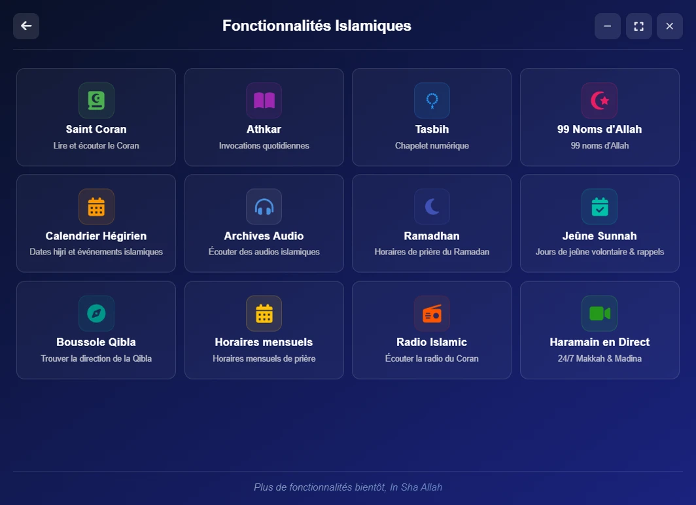
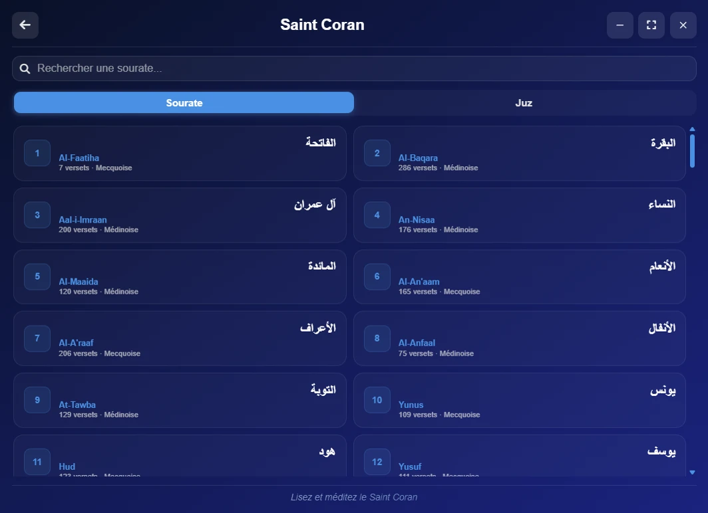
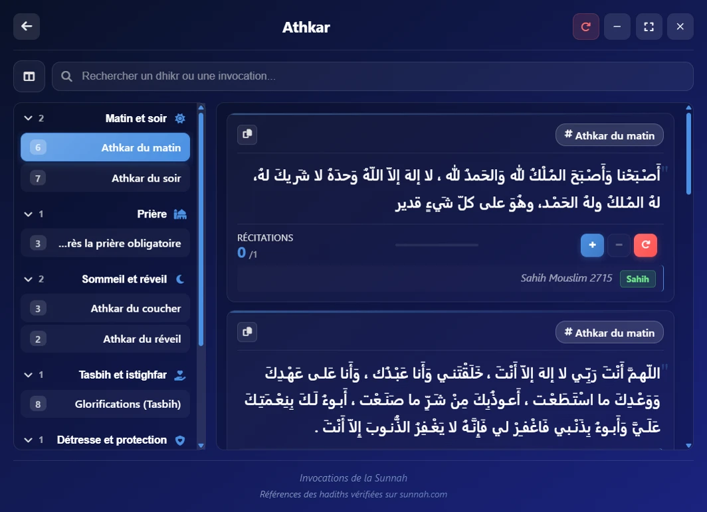
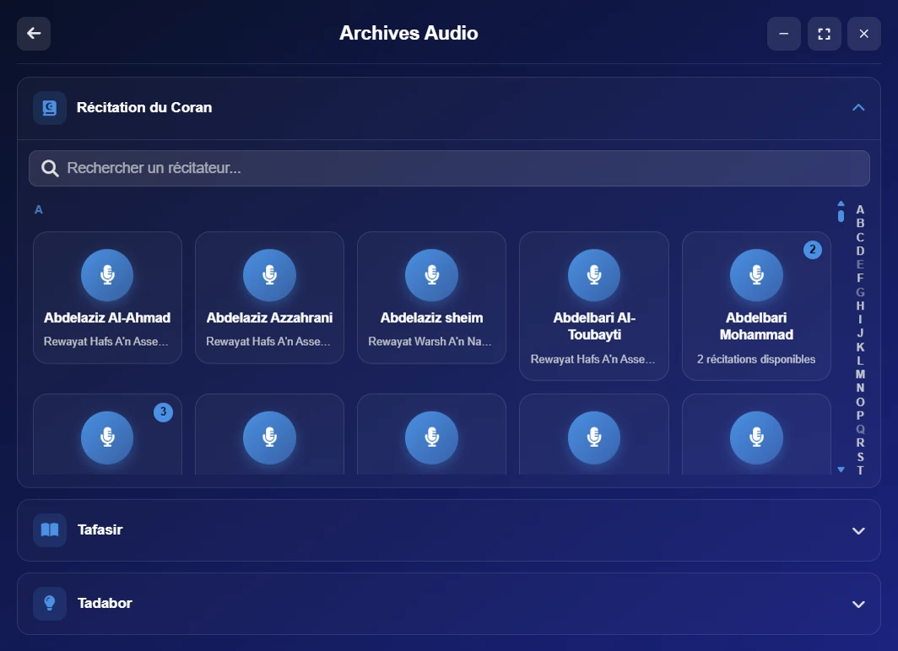
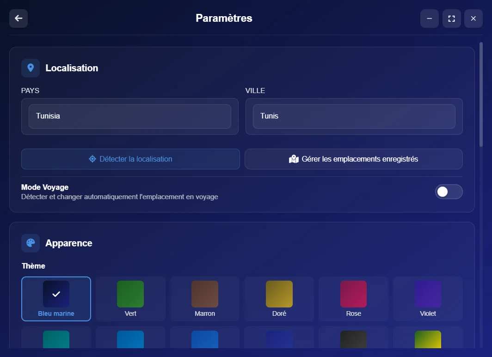

<div align="center">

# 🕌 Salaty Time

Une application islamique complète pour ordinateur : heures de prière, le Saint Coran, les athkar et plus encore, dans une seule application légère

[](https://github.com/yassindaboussi/Salaty/releases/latest)
[](LICENSE)
[](#-téléchargement)

[English](README.md) · [العربية](README.ar.md) · **Français**

</div>

---

## 📑 Sommaire

- [Aperçu](#-aperçu)
- [Téléchargement](#-téléchargement)
- [Captures d'écran](#-captures-décran)
- [Fonctionnalités](#-fonctionnalités)
- [Technologies](#️-technologies)
- [Structure du projet](#-structure-du-projet)
- [Développement](#-développement)
- [Contribuer](#-contribuer)
- [Licence](#-licence)

---

## 🌙 Aperçu

Une application de bureau qui réunit ce dont un musulman a besoin au quotidien : les heures de prière, un lecteur du Coran, une archive audio de récitations, de tadabbur et de tafsir, les athkar et d'autres outils islamiques. Elle est disponible en arabe, en anglais et en français, et la plupart des fonctionnalités importantes marchent sans connexion Internet.

---

## 📥 Téléchargement

| Système | Fichier | Remarques |
| --- | --- | --- |
| Windows 10/11 | [Salaty-Time-Setup.exe](https://github.com/yassindaboussi/Salaty/releases/latest/download/Salaty-Time-Setup.exe) | 64 bits |
| macOS 13+ | [Salaty-Time-mac-universal.dmg](https://github.com/yassindaboussi/Salaty/releases/latest/download/Salaty-Time-mac-universal.dmg) | Apple silicon et Intel |
| Linux | [Salaty-Time-linux-amd64.deb](https://github.com/yassindaboussi/Salaty/releases/latest/download/Salaty-Time-linux-amd64.deb) | Ubuntu, Debian, Linux Mint. Les versions arm64 et AppImage pour les autres distributions sont sur la [page des versions](https://github.com/yassindaboussi/Salaty/releases/latest) |

- **Windows :** l'installateur n'est pas encore signé numériquement, Windows peut donc afficher « Windows a protégé votre ordinateur » (SmartScreen) : cliquez sur **Informations complémentaires**, puis sur **Exécuter quand même**.
- **macOS :** l'application n'est pas notariée par Apple : ouvrez-la une fois, puis dans **Réglages Système → Confidentialité et sécurité**, cliquez sur **Ouvrir quand même**.
- **Mises à jour :** l'application trouve elle-même les nouvelles versions. Sous Windows et Linux, elle les installe ; sous macOS, elle ouvre la page de téléchargement.
- **Vérifier votre téléchargement :** chaque version contient `SHA256SUMS.txt`, et chaque fichier possède une attestation de build GitHub : `gh attestation verify <fichier> --repo yassindaboussi/Salaty`

---

## 📸 Captures d'écran

<div align="center">


<br/>


<br/>


</div>

---

## ✨ Fonctionnalités

### 🕌 Heures de prière
- Détection de votre position au démarrage (désactivable), avec plusieurs lieux enregistrés
- Adhan à l'heure de la prière, et rappel facultatif un nombre de minutes choisi avant
- Un petit widget sur le bureau qui affiche le temps restant avant la prochaine prière

### 📖 Saint Coran
- Un lecteur qui affiche les versets en texte continu, comme dans le Mushaf, et non une carte par verset
- Traductions anglaise et française, avec l'option de n'afficher que la traduction
- Une copie complète du Coran dans l'application, utilisée automatiquement hors connexion
- Réglage de la taille du texte et mode plein écran

### 🎧 Archive audio
- Récitation du Coran : plus de 200 récitateurs, classés par ordre alphabétique avec un index pour naviguer rapidement
- Tadabbur : des méditations audio pour chaque sourate
- Tafsir : des livres de tafsir audio (comme le Tafsir d'al-Tabari), classés par sourate

### 🤲 Adoration et outils islamiques
- Athkar du matin et du soir avec des rappels réguliers 📿
- Tasbih numérique 🔢
- Les 99 noms d'Allah 🌟
- Calendrier hégirien 🗓️
- Direction de la Qibla 🧭
- Outils pour le Ramadan 🌙
- Radio islamique et diffusions en direct 📻

### ⚙️ Paramètres
- 12 thèmes de couleurs
- 3 langues (arabe, anglais, français)
- Chaque modification est enregistrée automatiquement, sans bouton « Enregistrer »
- Mises à jour automatiques

---

## 🛠️ Technologies

| Domaine | Technologie |
| --- | --- |
| Application de bureau | Electron |
| Interface | HTML / CSS / JavaScript (sans framework) |
| Heures de prière | API Aladhan, mise en cache pour le mode hors connexion |
| Données du Coran | API AlQuran Cloud + copie locale de secours |
| Audio | API mp3quran.net |
| Build et distribution | electron-builder, GitHub Actions |
| Qualité du code | ESLint, Stylelint, Prettier, vérification des types TypeScript (JSDoc) |

---

## 📂 Structure du projet

```
src/
├── main/            # processus principal Electron (fenêtres, IPC, paramètres, services)
├── preload/         # pont entre les pages et le système
├── shared/          # partagé par les deux côtés (liste des canaux IPC)
├── assets/          # icônes, images, son de l'adhan, images du Microsoft Store
└── renderer/
    ├── pages/       # pages HTML
    ├── js/          # logique de chaque page et fonctionnalité (voir src/renderer/js/README.md)
    ├── css/         # styles
    ├── data/        # données intégrées (Coran, athkar...)
    ├── locales/     # traductions (ar / en / fr)
    └── fonts/       # polices intégrées
docs/                # site web (GitHub Pages) et captures d'écran
```

---

## 🚀 Développement

```bash
npm install            # installer les dépendances
npm run dev            # lancer l'application en mode développement
npm run build          # construire l'installateur
npm run build:linux    # construire uniquement les paquets Linux
npm run lint           # toutes les vérifications : code, types, architecture, CSS, traductions, format
npm run lint:types     # vérification des types uniquement (TypeScript sur le code JavaScript)
npm run format         # formater le code
npm run audit:check    # vérifier les failles de sécurité des dépendances
npm run assets:store   # images du Microsoft Store (après un changement d'icône)
```

**Publier une nouvelle version :** voir [RELEASING.md](RELEASING.md) (en anglais).

**Configuration requise :** Windows 10 ou plus récent (64 bits), macOS 13 ou plus récent, Linux (x64 ou arm64).
**Pour le développement :** Node.js 22.12 ou plus récent.

---

## 🤝 Contribuer

1. 🍴 Forkez le projet, créez une branche, faites votre modification, puis ouvrez une Pull Request
2. 🐛 Un bug ou une idée ? Ouvrez une [issue](https://github.com/yassindaboussi/Salaty/issues) ou lancez une [discussion](https://github.com/yassindaboussi/Salaty/discussions)

---

## 📄 Licence

Publié sous licence MIT : voir [LICENSE](LICENSE).

<div align="center">

Fait avec ❤️ par [Yassin Daboussi](mailto:salatytime@gmail.com)

</div>
