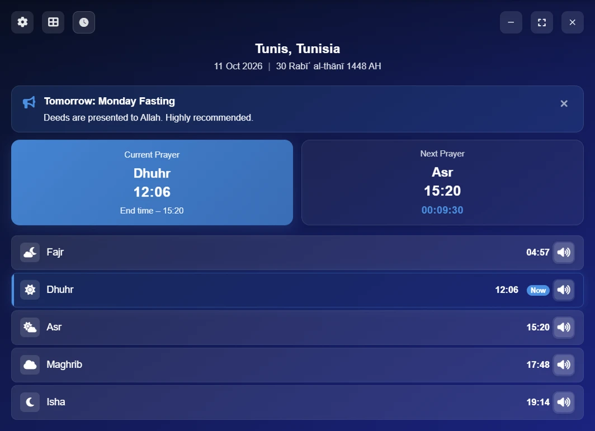
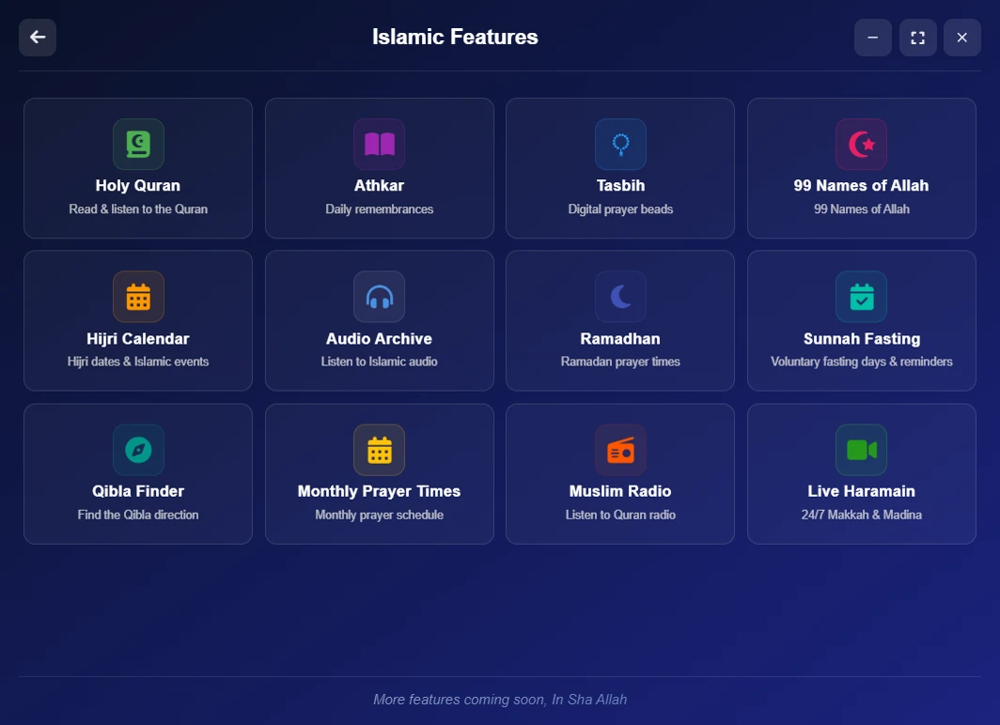
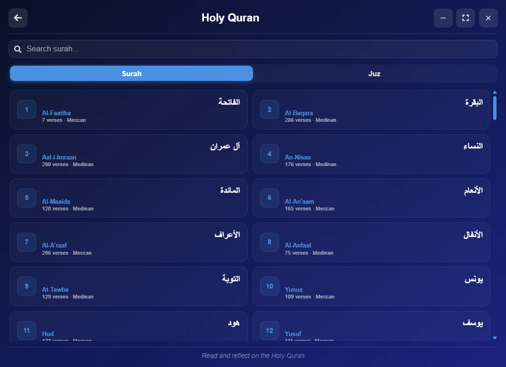
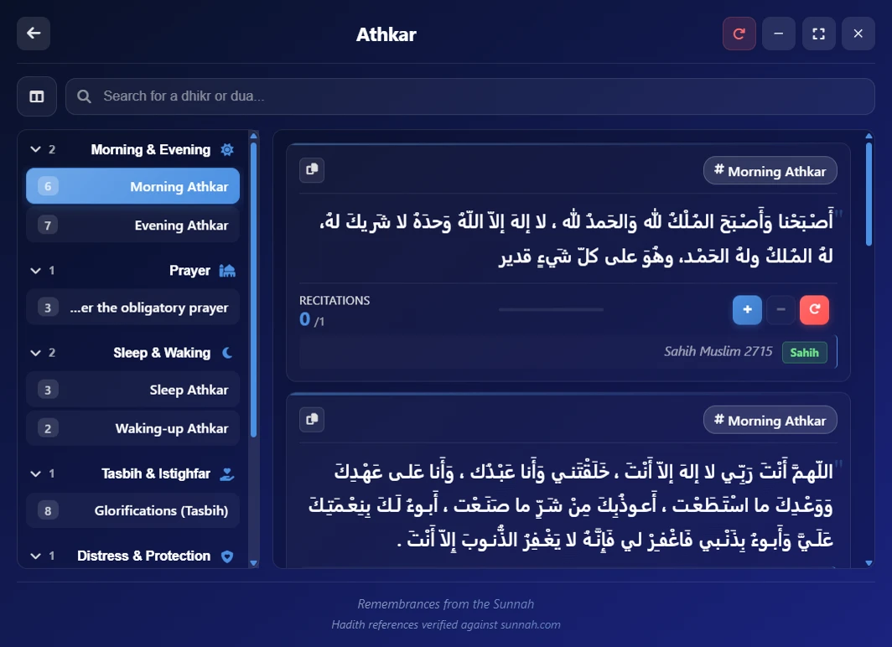
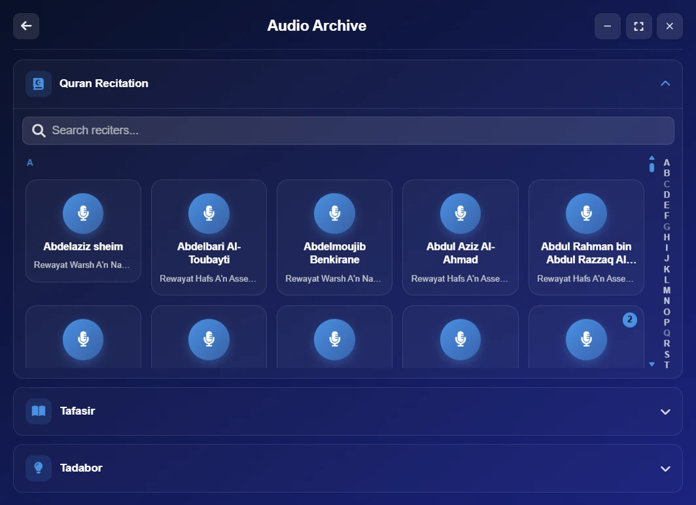
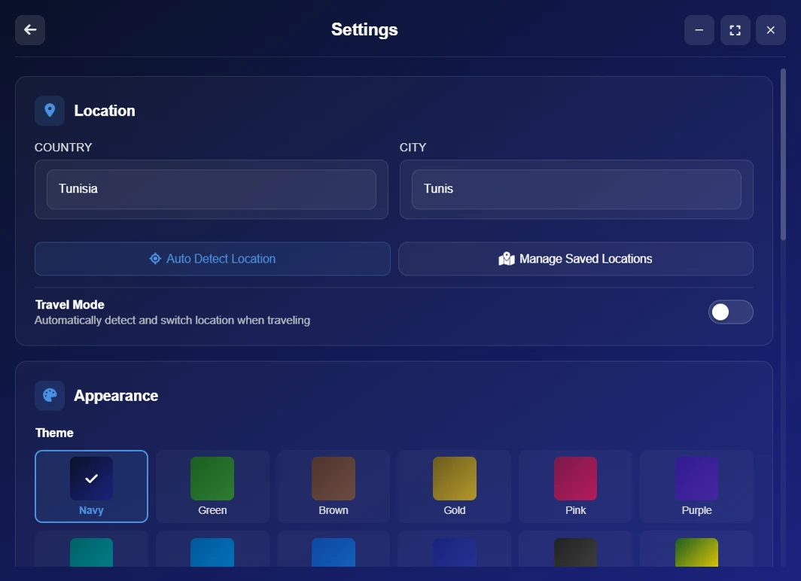

<div align="center">

# 🕌 Salaty Time

A complete Islamic desktop app: prayer times, the Holy Quran, athkar and more, in one light app

[](https://github.com/yassindaboussi/Salaty/releases/latest)
[](LICENSE)
[](#-download)

**English** · [العربية](README.ar.md) · [Français](README.fr.md)

</div>

---

## 📑 Contents

- [Overview](#-overview)
- [Download](#-download)
- [Screenshots](#-screenshots)
- [Features](#-features)
- [Tech stack](#️-tech-stack)
- [Project structure](#-project-structure)
- [Development](#-development)
- [Contributing](#-contributing)
- [License](#-license)

---

## 🌙 Overview

A desktop app that brings together what a Muslim needs every day: prayer times, a Quran reader, an audio archive of recitations, tadabbur and tafsir, athkar, and other Islamic tools. It is available in Arabic, English and French, and most important features work without an internet connection.

---

## 📥 Download

| System | File | Notes |
| --- | --- | --- |
| Windows 10/11 | [Salaty-Time-Setup.exe](https://github.com/yassindaboussi/Salaty/releases/latest/download/Salaty-Time-Setup.exe) | 64-bit |
| macOS 13+ | [Salaty-Time-mac-universal.dmg](https://github.com/yassindaboussi/Salaty/releases/latest/download/Salaty-Time-mac-universal.dmg) | Apple silicon and Intel |
| Linux | [Salaty-Time-linux-amd64.deb](https://github.com/yassindaboussi/Salaty/releases/latest/download/Salaty-Time-linux-amd64.deb) | Ubuntu, Debian, Linux Mint. arm64 and AppImage builds for other distributions are on the [releases page](https://github.com/yassindaboussi/Salaty/releases/latest) |

- **Windows:** the installer is not digitally signed yet, so Windows may show "Windows protected your PC" (SmartScreen): click **More info**, then **Run anyway**.
- **macOS:** the app is not notarized by Apple: open it once, then in **System Settings → Privacy & Security** click **Open Anyway**.
- **Updates:** the app finds new versions by itself. On Windows and Linux it installs them; on macOS it opens the download page.
- **Verify your download:** every release includes `SHA256SUMS.txt`, and every file has a GitHub build attestation: `gh attestation verify <file> --repo yassindaboussi/Salaty`

---

## 📸 Screenshots

<div align="center">


<br/>


<br/>


</div>

---

## ✨ Features

### 🕌 Prayer times
- Detects your location at start-up (can be turned off), and keeps several saved locations
- Adhan when the prayer time comes in, and an optional reminder a chosen number of minutes before
- A small desktop widget showing the time left until the next prayer

### 📖 Holy Quran
- A reader that shows the verses as continuous Mushaf text, not one card per verse
- English and French translations, with an option to show only the translation
- A complete copy of the Quran inside the app, used automatically when you are offline
- Font size control and full-screen mode

### 🎧 Audio archive
- Quran recitation: more than 200 reciters, sorted alphabetically with an index for quick navigation
- Tadabbur: audio reflections for every surah
- Tafsir: audio books of tafsir (such as Tafsir al-Tabari), organised by surah

### 🤲 Worship and Islamic tools
- Morning and evening athkar with periodic reminders 📿
- Digital tasbih 🔢
- The 99 Names of Allah 🌟
- Hijri calendar 🗓️
- Qibla direction 🧭
- Ramadan tools 🌙
- Islamic radio and live streams 📻

### ⚙️ Settings
- 12 colour themes
- 3 languages (Arabic, English, French)
- Every change is saved automatically, with no "Save" button
- Automatic updates
- "Send feedback" from inside the app: report a problem or suggest an idea in a few clicks

---

## 🛠️ Tech stack

| Area | Technology |
| --- | --- |
| Desktop app | Electron |
| Interface | HTML / CSS / JavaScript (no framework) |
| Prayer times | Aladhan API, cached for offline use |
| Quran data | AlQuran Cloud API + bundled offline copy |
| Audio | mp3quran.net API |
| Build and distribution | electron-builder, GitHub Actions |
| Code quality | ESLint, Stylelint, Prettier, TypeScript type checks (JSDoc) |

---

## 📂 Project structure

```
src/
├── main/            # Electron main process (windows, IPC, settings, services)
├── preload/         # bridge between the pages and the system
├── shared/          # shared by both sides (list of IPC channels)
├── assets/          # icons, images, adhan sound, Microsoft Store tiles
└── renderer/
    ├── pages/       # HTML pages
    ├── js/          # logic of each page and feature (see src/renderer/js/README.md)
    ├── css/         # styles
    ├── data/        # bundled data (Quran, athkar...)
    ├── locales/     # translations (ar / en / fr)
    └── fonts/       # bundled fonts
docs/                # website (GitHub Pages) and screenshots
```

---

## 🚀 Development

```bash
npm install            # install dependencies
npm run dev            # run the app in development mode
npm run build          # build the installer
npm run build:linux    # build the Linux packages only
npm run lint           # all checks: code, types, architecture, CSS, translations, formatting
npm run lint:types     # type checks only (TypeScript on the JavaScript code)
npm run format         # format the code
npm run audit:check    # check dependencies for security advisories
npm run assets:store   # Microsoft Store images (after changing the app icon)
```

**Publishing a new version:** see [RELEASING.md](RELEASING.md).

**System requirements:** Windows 10 or later (64-bit), macOS 13 or later, Linux (x64 or arm64).
**For development:** Node.js 22.13 or later.

---

## 🤝 Contributing

1. 🍴 Fork the project, create a branch, make your change, then open a Pull Request
2. 🐛 Found a bug or have an idea? Open an [issue](https://github.com/yassindaboussi/Salaty/issues) or start a [discussion](https://github.com/yassindaboussi/Salaty/discussions)

---

## 📄 License

Released under the MIT license: see [LICENSE](LICENSE).

<div align="center">

Made with ❤️ by [Yassin Daboussi](mailto:salatytime@gmail.com)

</div>
