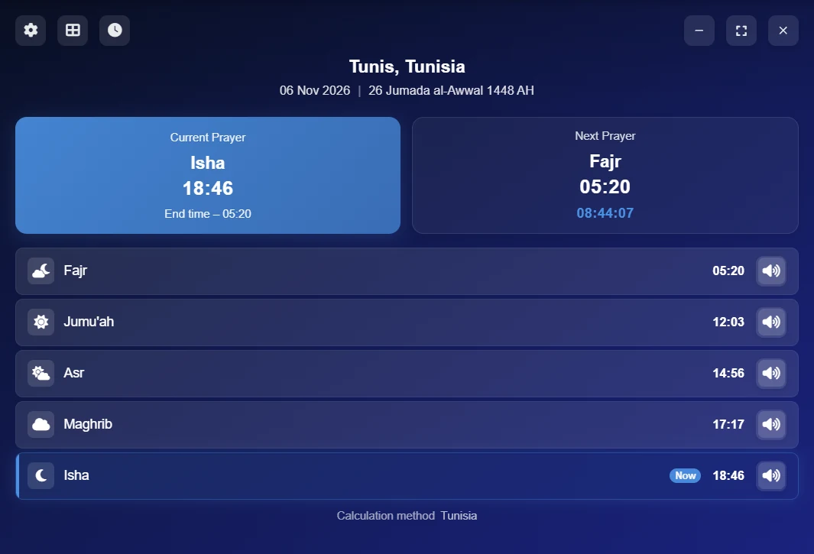
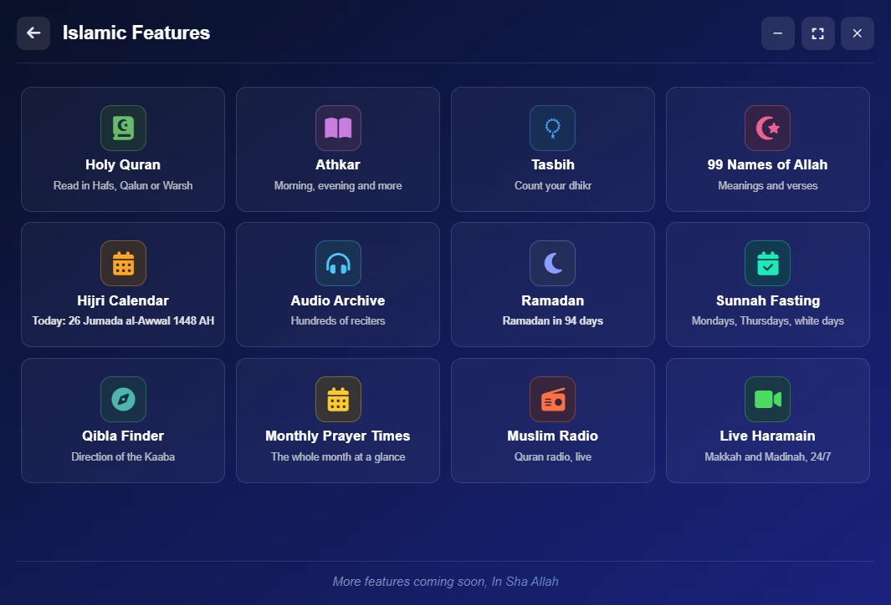
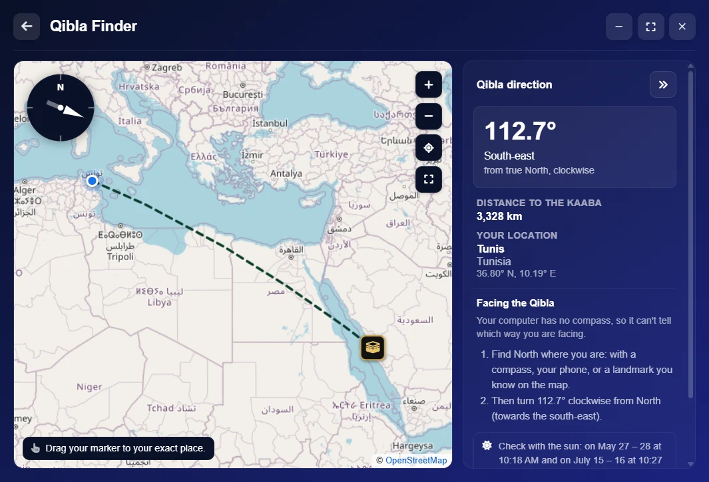
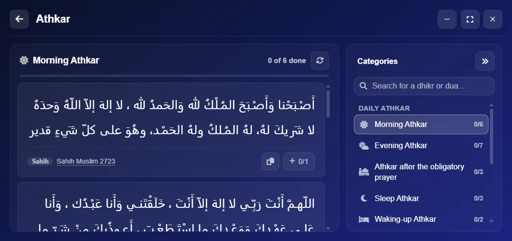
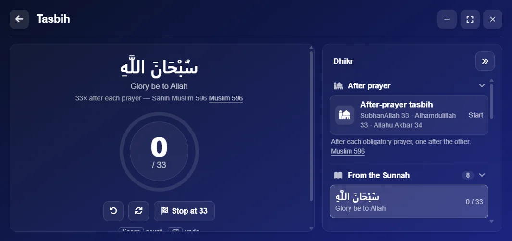
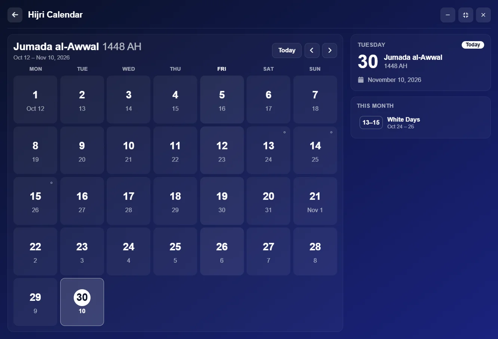
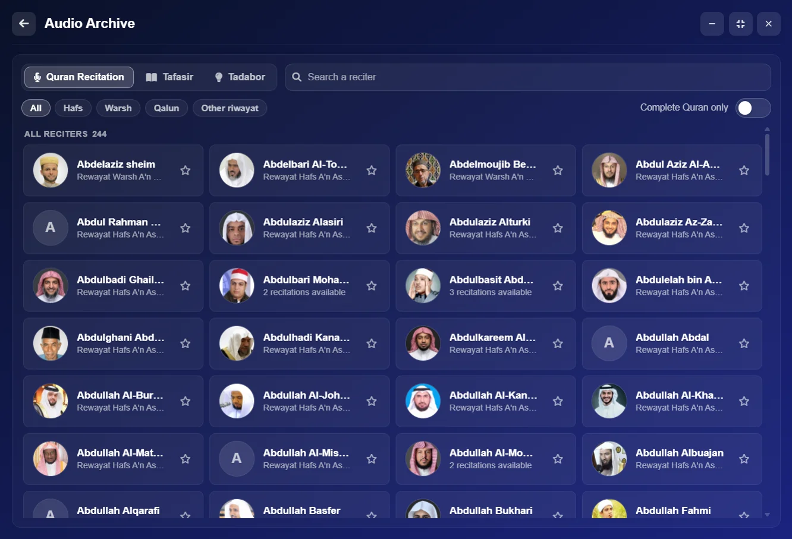
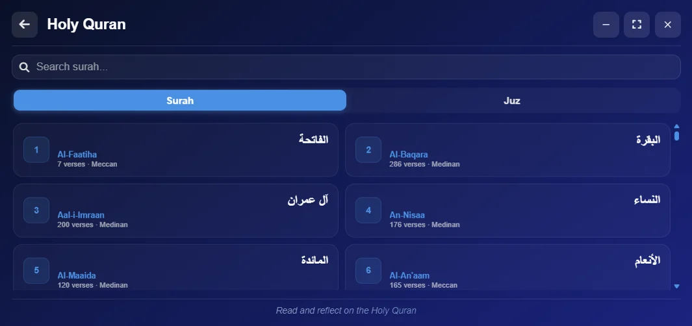
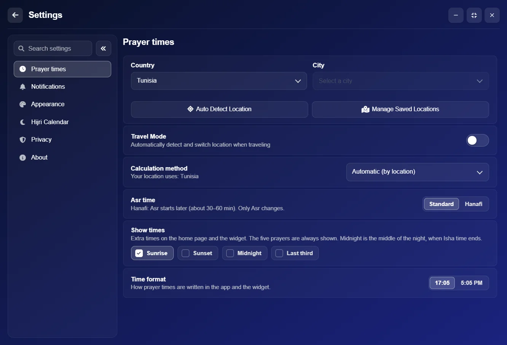

<div align="center">

# 🕌 Salaty Time

A complete Islamic desktop app: prayer times, the Holy Quran, athkar and more, in one light app

[](https://github.com/yassindaboussi/Salaty/releases/latest)
[](LICENSE)
[](#-download)

**English** · [العربية](README.ar.md) · [Français](README.fr.md)

</div>

---

## 📑 Contents

- [Overview](#-overview)
- [Download](#-download)
- [Screenshots](#-screenshots)
- [Features](#-features)
- [Tech stack](#️-tech-stack)
- [Project structure](#-project-structure)
- [Development](#-development)
- [Contributing](#-contributing)
- [License](#-license)

---

## 🌙 Overview

A desktop app that brings together what a Muslim needs every day: prayer times, a Quran reader, an audio archive of recitations, tadabbur and tafsir, athkar, and other Islamic tools. It is available in Arabic, English and French, and most important features work without an internet connection.

---

## 📥 Download

| System | File | Notes |
| --- | --- | --- |
| Windows 10/11 | [Salaty-Time-Setup.exe](https://github.com/yassindaboussi/Salaty/releases/latest/download/Salaty-Time-Setup.exe) | 64-bit |
| macOS 13+ | [Salaty-Time-mac-universal.dmg](https://github.com/yassindaboussi/Salaty/releases/latest/download/Salaty-Time-mac-universal.dmg) | Apple silicon and Intel |
| Linux | [Salaty-Time-linux-amd64.deb](https://github.com/yassindaboussi/Salaty/releases/latest/download/Salaty-Time-linux-amd64.deb) | Ubuntu, Debian, Linux Mint. arm64 and AppImage builds for other distributions are on the [releases page](https://github.com/yassindaboussi/Salaty/releases/latest) |

- **Windows:** the installer is not digitally signed yet, so Windows may show "Windows protected your PC" (SmartScreen): click **More info**, then **Run anyway**.
- **macOS:** the app is not notarized by Apple: open it once, then in **System Settings → Privacy & Security** click **Open Anyway**.
- **Updates:** the app finds new versions by itself. On Windows and Linux it installs them; on macOS it opens the download page.
- **Verify your download:** every release includes `SHA256SUMS.txt`, and every file has a GitHub build attestation: `gh attestation verify <file> --repo yassindaboussi/Salaty`

---

## 📸 Screenshots

<div align="center">


<br/>


<br/>


<br/>


<br/>

</div>

---

## ✨ Features

### 🕌 Prayer times
- Detects your location at start-up (can be turned off), and keeps several saved locations
- Adhan when the prayer time comes in, set per prayer (full adhan, a short tone, notification only, or off), and an optional reminder a chosen number of minutes before
- Choose the adhan voice: five recordings (Makkah by default), your own audio file, and a separate voice for Fajr
- Calculation method chosen automatically for your location, or picked from 23 methods (Muslim World League, Umm al-Qura, Karachi, ISNA…), and Asr by the standard or the Hanafi rule
- Jumu'ah shown in place of Dhuhr on Fridays
- Prayer times calculated on your device when the internet is not available
- Extra times you can show: sunrise, sunset, midnight and the last third of the night
- 24-hour or 12-hour time format
- A small desktop widget with all five prayers and the time left until the next one
- A monthly timetable

### 📖 Holy Quran
- A reader that shows the verses as continuous Mushaf text, not one card per verse
- Browse by surah or by juz
- Three riwayat: Hafs, Qalun and Warsh (Qalun and Warsh text from the King Fahd Complex), all available offline
- English (Sahih International, Muhammad Asad) and French (Hamidullah) translations, with an option to show only the translation
- Continue reading where you stopped, and bookmark any ayah
- A complete copy of the Quran inside the app, used automatically when you are offline
- Search a word in all the verses, or find it inside a surah
- Listen while reading: pick a reciter, the recited ayah is followed on the page, Space to play or pause
- Ayah numbers drawn in each riwaya's own style
- Font size control (also by pinching the touchpad), Arabic or Western numerals, and full-screen mode

### 🎧 Audio archive
- Quran recitation: more than 240 reciters with their photos, filters by riwaya (Hafs, Warsh, Qalun…), favourites and a playlist
- Tadabbur: audio reflections for every surah
- Tafsir: audio books of tafsir (such as Tafsir al-Tabari), organised by surah

### 🤲 Worship and Islamic tools
- **Athkar** 📿: morning, evening, after prayer, sleep and more, with a counter for each one, references checked against sunnah.com, and reminders
- **Tasbih** 🔢: the after-prayer tasbih step by step, the dhikr of the Sunnah, and your own
- **The 99 Names of Allah** 🌟 with the verses they come from
- **Hijri calendar** 🗓️ with Islamic events and the White Days
- **Sunnah fasting** 🌙: Mondays and Thursdays, the White Days, Arafah, Ashura and more, with reminders
- **Qibla finder** 🧭: the direction and distance to the Kaaba on a map, along the shortest route; drag your marker to your exact place, and check the direction with the sun twice a year
- **Ramadan** tools, **Muslim radio** 📻 and the official **live streams from Makkah and Madinah**

### ⚙️ Settings
- A side menu with search, or everything on one page
- 12 colour themes, including a dark theme
- 3 languages (Arabic, English, French)
- Every change is saved automatically, with no "Save" button
- Updates inside the app: see the download progress, keep using the app meanwhile, and restart when it suits you
- "Send feedback" from inside the app: report a problem or suggest an idea in a few clicks

---

## 🛠️ Tech stack

| Area | Technology |
| --- | --- |
| Desktop app | Electron |
| Interface | HTML / CSS / JavaScript (no framework) |
| Prayer times | Aladhan API, cached for offline use; calculated on the device with [PrayTimes](https://praytimes.org) when Aladhan can't be reached (city coordinates: [Open-Meteo](https://open-meteo.com), GeoNames data) |
| Quran data | Bundled Hafs, Qalun and Warsh text (offline) + AlQuran Cloud API for translations |
| Audio | mp3quran.net API |
| Build and distribution | electron-builder, GitHub Actions |
| Code quality | ESLint, Stylelint, Prettier, TypeScript type checks (JSDoc) |

---

## 📂 Project structure

```
src/
├── main/            # Electron main process (windows, IPC, settings, services)
├── preload/         # bridge between the pages and the system
├── shared/          # shared by both sides (IPC channels, prayer and fasting rules, Aladhan requests)
├── assets/          # icons, images, adhan sound, Microsoft Store tiles
└── renderer/
    ├── pages/       # HTML pages
    ├── js/          # logic of each page and feature (see src/renderer/js/README.md)
    ├── css/         # styles
    ├── data/        # bundled data (Quran, athkar...)
    ├── locales/     # translations (ar / en / fr)
    └── fonts/       # bundled fonts
docs/                # website (GitHub Pages) and screenshots
```

---

## 🚀 Development

```bash
npm install            # install dependencies
npm run dev            # run the app in development mode
npm run build          # build the installer
npm run build:linux    # build the Linux packages only
npm run lint           # all checks: code, types, architecture, CSS, translations, formatting
npm run lint:types     # type checks only (TypeScript on the JavaScript code)
npm run format         # format the code
npm run audit:check    # check dependencies for security advisories
npm run assets:store   # Microsoft Store images (after changing the app icon)
```

**Publishing a new version:** see [RELEASING.md](RELEASING.md).

**System requirements:** Windows 10 or later (64-bit), macOS 13 or later, Linux (x64 or arm64).
**For development:** Node.js 22.13 or later.

---

## 🤝 Contributing

1. 🍴 Fork the project, create a branch, make your change, then open a Pull Request
2. 🐛 Found a bug or have an idea? Open an [issue](https://github.com/yassindaboussi/Salaty/issues) or start a [discussion](https://github.com/yassindaboussi/Salaty/discussions)

---

## 📄 License

Released under the MIT license: see [LICENSE](LICENSE).

<div align="center">

Made with ❤️ by [Yassin Daboussi](mailto:salatytime@gmail.com)

</div>
